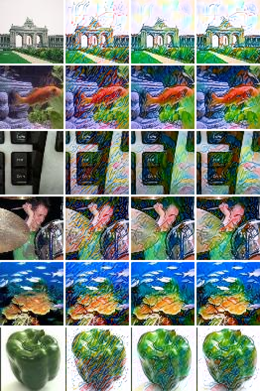
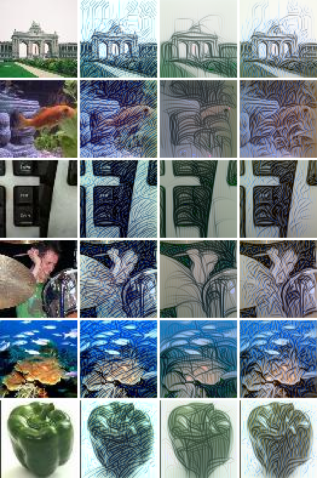
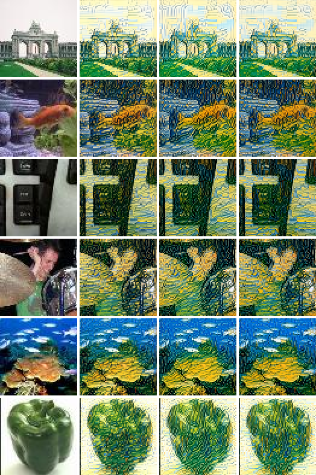

# Clip-Guided Diffusion for Tiny ImageNet

This repository contains a CLIP-guided diffusion pipeline for the Tiny ImageNet dataset (64x64 resolution). It builds on the DiffusionCLIP architecture to perform text-driven image manipulation, fine-tuning, and latent optimization.

This revision makes the pipeline actually run (it could not be imported before), makes it fast on Apple Silicon, and adds an **optimal-transport (Sinkhorn) directional CLIP loss**, compared against the standard DiffusionCLIP loss below.

- [Bugs fixed](#bugs-fixed)
- [Apple Silicon optimisation](#apple-silicon-optimisation)
- [Optimal-transport directional loss](#optimal-transport-directional-loss)
- [Results: directional loss vs. optimal transport](#results-directional-loss-vs-optimal-transport)
- [Installation](#installation) · [Usage](#usage) · [Reproducing the numbers](#reproducing-the-numbers)

## Features

- **Text-Driven Manipulation**: Edit images using simple text prompts by leveraging the power of CLIP to guide the diffusion process.
- **Multiple Operational Modes**: Support for zero-shot editing, model fine-tuning, single image editing, and latent optimization.
- **Optimal-Transport Guidance**: an optional Sinkhorn-divergence CLIP loss (`--lambda_ot`) that matches distributions of edit directions instead of their means.
- **Apple Silicon Support**: runs on the Metal (MPS) GPU, 4.6–9.5x faster than the CPU path the original code fell back to on a Mac.
- **Gradio Monitoring UI**: A live web interface to monitor training losses and visualize real-time generated image transitions.
- **Configurable Pipeline**: Easily tweak diffusion steps, loss weights, dataset parameters, and text prompts via shell scripts and YAML configs.

## Bugs fixed

The original code could not be imported, and once that was fixed it failed at several further points before producing an image. Everything below was reproduced and then verified fixed by running the pipeline end-to-end on Tiny ImageNet.

### Crashes: the pipeline could not run

| # | Where | Problem | Fix |
|---|---|---|---|
| 1 | `diffusionclip.py` | `IndentationError` at lines 351 and 785, left by `patch.py`'s string injection, so the module could not even be imported. | Re-indented; removed the one-shot `patch.py` (re-running it would inject the blocks a second time). |
| 2 | `models/improved_ddpm/script_util.py` | `i_DDPM('TINY_IMAGENET')` had no config: it printed "Not implemented" and called `exit()`. | Added the guided-diffusion 64x64 architecture (296M params, all checkpoint keys match). |
| 3 | `diffusionclip.py` | `clip_finetune` and `unseen2unseen` raised `ValueError` for any dataset other than the ones whitelisted for checkpoint URLs, including `TINY_IMAGENET`. | Model loading collapsed from six copy-pasted blocks into one `load_model()`. |
| 4 | `datasets/TINY_IMAGENET_dataset.py` | `ImageFolder` yields `(image, label)` tuples, but every loop calls `img.to(device)`. The val split was read as a single class. | Dataset returns image tensors, reads `val_annotations.txt`, supports `class_num`. |
| 5 | `diffusionclip.py` | `IDLoss()` (ArcFace face-recognition weights) was always constructed in `clip_finetune`/`clip_latent_optim`, so the run crashed without the face checkpoint even with `--id_loss_w 0`. | Built only when `id_loss_w > 0`. |
| 6 | `main.py` | Config path was joined twice (`configs/configs/tiny_imagenet.yml`) for the documented `--config configs/tiny_imagenet.yml`. | Accepts both forms. |
| 7 | `main.py` | Referenced the undefined `args.recon_exp` / `args.find_best_image` (`AttributeError`), and `--edit_one_image_eff` called a method that does not exist. | Dead branches and flag removed. |
| 8 | `main.py` | `--clip_loss_w` was `type=int`, so the `3.0` passed by `run_script.sh` was rejected. | `type=float`. |
| 9 | `run_script.sh` | No mode flag ("Choose one mode!"), `--save_train_image` without its value, `--edit_attr ""` (`KeyError`), and `t_0` tied to the step count (`t_0=20` adds almost no noise, so nothing gets edited). | Rewritten with `--clip_finetune_eff`, `t_0=500` and separate step counts. |
| 10 | everywhere | `torch.load` without `map_location`: CUDA-saved checkpoints/latents fail to load on a Mac. | `map_location` everywhere. |
| 11 | `diffusionclip.py`, `utils/align_utils.py` | `Image.ANTIALIAS` was removed in Pillow 10. | `Image.LANCZOS`. |
| 12 | `diffusionclip.py` | `dlib` was imported at module import even though only face alignment needs it. | Imported lazily. |
| 13 | `main.py` | Exceptions were logged and the process still exited with status 0. | Exit status 1 on failure. |

### Silent correctness bugs

| # | Where | Problem | Fix |
|---|---|---|---|
| 14 | `utils/diffusion_utils.py`, `configs/tiny_imagenet.yml` | `get_beta_schedule` ignored `beta_schedule` and always returned a **linear** schedule, but `64x64_diffusion.pt` was trained with the **cosine** schedule. | Cosine schedule implemented and selected. DDIM inversion → reconstruction of val images improves from **34.6 dB to 39.7 dB PSNR**. |
| 15 | `diffusionclip.py` (`clip_finetune_eff`) | The ID loss was computed on the detached `x` instead of `x0_t`, so it never produced a gradient. | Uses `x0_t`. |
| 16 | `diffusionclip.py` (`clip_finetune`) | Evaluation relied on the leftover loop variable `mode`; latents loaded from disk were not moved to the device; timesteps were sized from `--bs_train` while the test loader uses batch 1 (shape assert for `bs_train > 1`). | Explicit `"test"`, `.to(device)`, timesteps sized from the batch. |
| 17 | `utils/diffusion_utils.py` | `out_x0_t=True` with `sampling_type='ddpm'` raised `UnboundLocalError`; the `eta > 0` check failed for batch > 1. | Fixed. |
| 18 | `models/improved_ddpm/unet.py` | `AttentionBlock` hard-coded gradient checkpointing to `True`, ignoring `use_checkpoint`: every backward pass recomputed all attention blocks and the recompute ran outside autocast (mixed precision crashed). | Respects `use_checkpoint`. |
| 19 | `ui.py` | Looked for images in `results/` while every run writes to `runs/`, so the dashboard was always empty. | Reads `runs/` (or a directory passed as argument). |
| 20 | `requirements.txt` | Missing torch, torchvision, CLIP, matplotlib and gradio. | Completed. |

## Apple Silicon optimisation

On a Mac the original code silently ran on the CPU (it only checked for CUDA). Measured on an **Apple M5 Pro (48 GB), macOS 27, PyTorch 2.15**, with the guided-diffusion 64x64 UNet (296M params) and CLIP ViT-B/16. Each MPS row adds one change to the row above it. Indented rows branch off the last kept configuration.

| Configuration | DDIM step, batch 1 | Fine-tune step, batch 1 | DDIM step, batch 8 | Fine-tune step, batch 8 |
|---|---:|---:|---:|---:|
| Original: CPU fp32 | 240 ms | 1207 ms | 1374 ms | 8729 ms |
| MPS fp32 (naive port) | 41 ms | 499 ms | 236 ms | 2921 ms |
| + no forced attention recompute | 41 ms | 490 ms | 234 ms | 2874 ms |
| + fused SDPA attention | 39 ms | 485 ms | 233 ms | 2966 ms |
| **+ CLIP patch-embed as matmul** | **39 ms** | **265 ms** | **235 ms** | **1182 ms** |
| &nbsp;&nbsp;+ `channels_last` (rejected) | 55 ms | 335 ms | 269 ms | 1255 ms |
| &nbsp;&nbsp;+ bf16 autocast | 41 ms | 319 ms | 145 ms | 885 ms |
| &nbsp;&nbsp;+ fp16 autocast (`--amp fp16`) | 41 ms | 262 ms | **145 ms** | 884 ms |
| **Speed-up vs. original** | **6.2x** | **4.6x** | **9.5x** (fp16) | **7.4x** |

*Fine-tune step* = one GPU-efficient DiffusionCLIP step: UNet forward, directional CLIP loss, backward and Adam update. Max |error| of the UNet output vs. CPU fp32 is ≤5e-5 for every fp32 configuration, 4.7e-3 for fp16 and 5e-2 for bf16 ([`benchmarks/results_apple_silicon.json`](benchmarks/results_apple_silicon.json)).

What changed and why:

- **MPS device selection** (`main.py`, `DiffusionCLIP`, `CLIPLoss`): CUDA → MPS → CPU, overridable with `--device`.
- **CLIP patch embedding as a matmul** (`losses/clip_loss.py: PatchEmbedMatmul`). This is the largest single win. On MPS, the backward of CLIP's 16x16/stride-16 patch-embedding `Conv2d` with respect to its input took **1.7 s for 8 images**; the identical patchify + matmul takes **1.4 ms**. CLIP guidance backpropagates exactly through that gradient, so this one op dominated every fine-tuning step. The replacement shares the conv's weights, is exact (unit-tested against `Conv2d` forward and both gradients), and is only installed on MPS.
- **Mixed precision for sampling** (`--amp fp16`): 1.6x faster DDIM steps at batch 8 and no gain at batch 1, which is bound by kernel-launch overhead. It is applied only to no-grad passes (inversion, sampling): without a GradScaler, fp16 activation gradients can underflow during fine-tuning. fp16 is used rather than bf16 because it is 10x more accurate here and equally fast.
- **No host↔device traffic in the sampling loop**: the variance schedule lives on the device instead of being copied from NumPy at every step, timesteps are created directly on the device, and the `t_next == -1` branch is computed with `torch.where` instead of a Python `if` on a GPU tensor (which forces a sync).
- **Attention**: forced recomputation removed (bug 18). Fused `scaled_dot_product_attention` is numerically identical (≤2e-6) but gives no measurable speed-up at 64x64, where attention is a small part of the UNet. It is kept for its lower memory use at larger resolutions.
- **Smaller fixes**: the RN50 CLIP model (~250 MB, only used by the texture loss) is no longer loaded on every run; `pin_memory` only on CUDA; `num_workers: 0` (macOS spawns workers, which costs more than loading a handful of 64x64 images).
- **Tried and rejected**: `channels_last` is 13–40% *slower* on MPS for this UNet.

## Optimal-transport directional loss

DiffusionCLIP's directional loss compares one image edit direction with one text direction:

$$\mathcal{L}_{dir} = 1 - \cos\big(E_I(x_{edit}) - E_I(x_{src}),\; \bar{t}\big), \qquad \bar t = \tfrac{1}{T}\textstyle\sum_{k} \big(E_T(\text{template}_k(\text{trg})) - E_T(\text{template}_k(\text{src}))\big)$$

Averaging the T = 79 prompt templates gives a direction that no individual prompt produces, and a single global image embedding is a noisy estimate of how the image changed.

`--lambda_ot` (implemented in [`losses/ot_loss.py`](losses/ot_loss.py) and `CLIPLoss.clip_ot_directional_loss`) keeps both sides as **distributions** and compares them with optimal transport:

- **Image side** μ: K edit directions `normalize(E_I(v_k(x_edit)) − E_I(v_k(x_src)))`, one per view v_k. The views are the full image plus K−1 random resized crops/flips, applied *identically* to source and edit, so each direction measures the edit rather than the augmentation (K = 8).
- **Text side** ν: the T = 79 per-template text directions, each normalised.
- **Cost**: C_ij = 1 − cos(μ_i, ν_j).
- **Loss**: the debiased Sinkhorn divergence (Feydy et al., 2019)

$$S_\varepsilon(\mu,\nu) = \mathrm{OT}_\varepsilon(\mu,\nu) - \tfrac12\mathrm{OT}_\varepsilon(\mu,\mu) - \tfrac12\mathrm{OT}_\varepsilon(\nu,\nu)$$

  The debiasing makes S_ε(μ, μ) = 0, so the entropic blur cannot be minimised by collapsing all views onto one direction.

Implementation details:

- **Log-domain Sinkhorn** (stable in fp32 on MPS; the CLIP features are fp16, so they are upcast first).
- **Gradients via the envelope theorem**: ∂OT_ε/∂C = P*. The potentials are found without autograd, and the backward pass is a single product with the transport plan instead of an unrolled graph of 100 `logsumexp`s.
- OT_ε(ν, ν) is constant per prompt and cached. The solver itself costs ~2 ms of the loss.
- Unit tests ([`tests/test_ot_loss.py`](tests/test_ot_loss.py)): marginals, convergence to the exact assignment-problem OT cost as ε → 0, gradient vs. finite differences, S_ε(x, x) = 0, and MPS == CPU.

`--lambda_direction` and `--lambda_ot` can be combined. OT alone is `--lambda_direction 0 --lambda_ot 1`.

## Results: directional loss vs. optimal transport

**Setup.** GPU-efficient fine-tuning (`--clip_finetune_eff`) of the 64x64 diffusion model for three edits from `photo`:

- t₀ = 500, 40 inversion steps, 6 training steps, 40 test steps
- 40 train images × 5 iterations, lr 4e-6, `clip_loss_w 3`, no L1/ID regularisation

All methods use the **same** precomputed train/test latents (Tiny-ImageNet train/val), so every comparison is paired, image by image. The guidance model is CLIP ViT-B/16. The edits are scored on 16 val images with a **held-out CLIP ViT-B/32**, so no method can score well by over-fitting the guidance model:

- **CLIP direction**: cosine between the image edit direction and the text edit direction (the standard DiffusionCLIP / StyleGAN-NADA metric).
- **CLIP target gain**: increase in similarity to the target text.
- **LPIPS / L1** to the source: content preservation, lower is better.

Methods:

- **direction**: DiffusionCLIP's loss (`--lambda_direction 1`).
- **ot**: the Sinkhorn loss alone (`--lambda_direction 0 --lambda_ot 1`).
- **direction+ot**: both (`--lambda_ot 2.5`, which balances the two gradient magnitudes measured at the start of fine-tuning).

| Edit | Method | CLIP direction ↑ | CLIP target gain ↑ | LPIPS ↓ | L1 ↓ | Train s/img |
|---|---|---:|---:|---:|---:|---:|
| photo → watercolor art | direction | 0.102 | +0.069 | 0.385 | 0.187 | 1.59 |
| | **ot** | **0.158** | +0.073 | **0.252** | **0.152** | 1.97 |
| | direction+ot | 0.148 | **+0.077** | 0.316 | 0.164 | 2.36 |
| photo → pencil sketch | direction | 0.104 | +0.078 | 0.340 | 0.196 | 1.58 |
| | ot | 0.095 | +0.072 | **0.328** | **0.183** | 1.99 |
| | direction+ot | **0.116** | **+0.082** | 0.349 | 0.198 | 2.51 |
| photo → painting by Gogh | direction | 0.161 | +0.131 | **0.422** | **0.193** | 1.67 |
| | ot | **0.167** | **+0.137** | 0.495 | 0.226 | 2.25 |
| | direction+ot | 0.166 | +0.135 | 0.469 | 0.219 | 2.82 |

Paired difference to the **direction** baseline: per-image mean ± 95% CI over the 16 test images, with the paired t-test p-value.

| Edit | Method | Δ CLIP direction | Δ LPIPS (negative = better preservation) |
|---|---|---:|---:|
| watercolor art | ot | **+0.056 ± 0.015** (p < 0.001) | **−0.133 ± 0.029** (p < 0.001) |
| watercolor art | direction+ot | **+0.046 ± 0.012** (p < 0.001) | **−0.069 ± 0.013** (p < 0.001) |
| pencil sketch | ot | −0.010 ± 0.014 (p = 0.16) | −0.012 ± 0.078 (p = 0.74) |
| pencil sketch | direction+ot | +0.011 ± 0.016 (p = 0.15) | +0.009 ± 0.042 (p = 0.64) |
| painting by Gogh | ot | +0.007 ± 0.009 (p = 0.15) | +0.073 ± 0.030 (p < 0.001) |
| painting by Gogh | direction+ot | +0.005 ± 0.007 (p = 0.14) | +0.047 ± 0.024 (p = 0.001) |

### Takeaways

- **Watercolor**: optimal transport is better on *both* axes at once. The edit follows the text direction 55% more closely (0.102 → 0.158) *and* preserves the source better (LPIPS 0.385 → 0.252). In the figure the baseline covers every image in the same high-frequency stroke texture; OT produces a cleaner wash that keeps the keyboard keys, the pepper and the arch legible.
- **Pencil sketch**: no significant difference for either OT variant. Visually they differ: OT produces sparse, monochrome line-drawing strokes, while the baseline keeps the source colours under a hatching texture. The held-out CLIP metric does not prefer either.
- **Van Gogh**: OT edits slightly more strongly (not significant) but changes the image more (LPIPS +0.07, significant). Here the baseline gives the better trade-off.
- **Cost**: OT computes CLIP features for 8 augmented views instead of 1, so training is 1.24–1.35x slower per image (the Sinkhorn solver itself is ~2 ms). The hybrid is 1.5–1.7x slower.
- **Recommendation**: OT is a useful option rather than a universal replacement. Try `--lambda_ot 1 --lambda_direction 0` when the baseline over-textures an edit.
- **Caveat**: one seed, one hyper-parameter setting and 16 test images per edit. The watercolor result is far outside its confidence interval; the others are within noise.

Edits on held-out val images, one image per class (triumphal arch, goldfish, computer keyboard, drumstick, coral reef, bell pepper). Columns: **source | direction (baseline) | OT | direction+OT**.

| photo → watercolor art | photo → pencil sketch | photo → painting by Gogh |
|---|---|---|
|  |  |  |

The combined loss needs care: DiffusionCLIP feeds the CLIP loss through −log((2 − L)/2), which assumes L ∈ [0, 2]. The weighted sum of two directional terms leaves that range (the first hybrid run was NaN from step 0), so the transform is now applied to each term separately (`CLIPLoss.directional_log_loss`). Single-term runs are unchanged by this.

## Installation

```bash
python3.13 -m venv .venv && source .venv/bin/activate
pip install -r requirements.txt

# pretrained 64x64 ImageNet diffusion model (guided-diffusion, 1.2 GB)
mkdir -p pretrained
curl -L -o pretrained/64x64_diffusion.pt https://openaipublic.blob.core.windows.net/diffusion/jul-2021/64x64_diffusion.pt

# Tiny ImageNet (240 MB)
mkdir -p data && curl -L -o data/tiny-imagenet-200.zip https://cs231n.stanford.edu/tiny-imagenet-200.zip
unzip -q data/tiny-imagenet-200.zip -d data && rm data/tiny-imagenet-200.zip
```

`data/`, `pretrained/`, `runs/`, `checkpoint/` and `precomputed/` are git-ignored. Only the small curated figures in `assets/` are committed.

## Usage

### 1. Training & Image Generation

To start the CLIP-guided fine-tuning on Tiny ImageNet, run the provided script:

```bash
bash run_script.sh
```

By default, the script fine-tunes the model so that "a photo" is edited towards "a beautiful landscape". You can modify `run_script.sh` to change the prompts, `t_0`, the diffusion steps, the loss weights and the OT weight (`LAMBDA_OT`).

Alternatively, you can run `main.py` directly:
```bash
python main.py --config configs/tiny_imagenet.yml \
    --clip_finetune_eff \
    --src_txts "photo" --trg_txts "watercolor art" \
    --t_0 500 --n_inv_step 40 --n_train_step 6 --n_test_step 40 \
    --n_precomp_img 40 --n_train_img 40 --n_test_img 16 --n_iter 5 \
    --lr_clip_finetune 4e-6 \
    --lambda_direction 0 --lambda_ot 1 \
    --exp runs/watercolor_ot
```

| Flag | Default | Meaning |
|---|---|---|
| `--clip_finetune` / `--clip_finetune_eff` | | Fine-tune through the whole generative process / GPU-efficient per-step fine-tuning |
| `--lambda_direction` | 1 | Weight of DiffusionCLIP's mean directional loss |
| `--lambda_ot` | 0 | Weight of the optimal-transport directional loss |
| `--ot_eps`, `--ot_n_views`, `--ot_n_iters` | 0.05, 8, 100 | Sinkhorn entropic regularisation, # augmented views, max iterations |
| `--device` | best available | `cuda`, `mps` or `cpu` |
| `--amp` | `none` | `fp16`/`bf16` autocast for inversion and sampling |

Outputs go to `runs/<exp>_FT_.../image_samples/` (`test_<i>_0_orig.png`, `test_<i>_2_clip_<target>_<iter>_ngen40.png`, `training_loss.png`) and the fine-tuned weights to `checkpoint/`.

### 2. Gradio Monitoring UI

While the training loop is running, you can track it via the Gradio interface, which refreshes with the latest loss plots and image transitions:

```bash
python ui.py            # or: python ui.py path/to/runs
```
Open `http://localhost:7860` in your browser to view the monitor.

## Reproducing the numbers

```bash
pytest tests                                        # OT solver + patch-embed equivalence
python benchmarks/bench_apple_silicon.py            # -> benchmarks/results_apple_silicon.json
python benchmarks/compare_ot.py                     # -> benchmarks/results_ot.{json,md}, assets/ot_comparison_*.png
python benchmarks/eval_edits.py --run_dir runs/<exp> --src_txt photo --trg_txt "watercolor art"
```

## Directory Structure
- `main.py`: Entry point for configuring and invoking the diffusion pipelines.
- `diffusionclip.py`: Core model class implementing the forward/reverse diffusion loops and losses.
- `losses/clip_loss.py`: Directional, global, patch and **optimal-transport** CLIP losses; MPS-fast CLIP loader.
- `losses/ot_loss.py`: Log-domain Sinkhorn and debiased Sinkhorn divergence.
- `utils/diffusion_utils.py`: Noise schedules (linear, cosine) and the DDIM/DDPM step.
- `benchmarks/`: Apple Silicon benchmark, OT comparison driver, edit-quality evaluation.
- `tests/`: Unit tests.
- `ui.py`: Gradio dashboard for real-time monitoring.
- `run_script.sh`: Main execution orchestration script.
- `configs/`: YAML configuration files (e.g., `tiny_imagenet.yml`).

## Acknowledgements
This project is built using the principles outlined in the [DiffusionCLIP](https://github.com/gwang-kim/DiffusionCLIP) framework. The 64x64 diffusion model is from OpenAI's [guided-diffusion](https://github.com/openai/guided-diffusion). The Sinkhorn divergence follows Feydy et al., *Interpolating between Optimal Transport and MMD using Sinkhorn Divergences* (AISTATS 2019).
